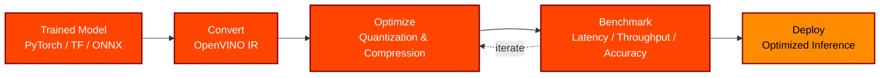
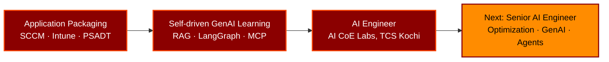

<div align="center">

<a href="https://github.com/aswathh">
  
</a>


<br/>


<br/>

<a href="https://www.linkedin.com/in/aswath-kumar-aba077225"></a>
<a href="https://github.com/aswathh?tab=repositories"></a>


</div>

<br/>

## 👨‍💻 whoami

```python
class AswathKumar:
    role       = "AI Engineer @ AI CoE Labs, TCS Kochi"
    project    = "INTEL  # model optimization & inferencing with OpenVINO"
    superpower = ["Model optimization", "RAG pipelines", "Multi-agent systems"]
    background = "Enterprise App Packaging (SCCM, Intune, PSADT) -> AI Engineering"
    learning   = ["INT8 / NNCF quantization", "LoRA / QLoRA", "MCP", "AWS Bedrock AgentCore"]
    mantra     = "Ship it. Measure it. Optimize it."
```

> [!TIP]
> I bring an **enterprise delivery mindset** (packaging, deployment, reliability) to **AI engineering**, so models are not just accurate, they are fast, lean and production-ready.

<hr/>

## 🏢 What I Do at TCS: Project INTEL

At **AI CoE Labs, TCS Kochi**, I work on **INTEL**, making AI models smaller, faster and deployment-ready for inference.



| ⚡ Optimize | 📉 Compress | 🚀 Infer | 🔬 Experiment |
|:--|:--|:--|:--|
| Convert and tune models with **OpenVINO** | Quantization and tuning to cut latency and memory | Benchmark and deploy optimized models on Intel hardware | Compare tools for the best accuracy / speed trade-off |

<hr/>

## 🛠️ Tech Arsenal

<div align="center">


<br/><br/>

<table>
<tr>
<td valign="top" width="50%">

**Model Optimization & Inference**
<br/><br/>


</td>
<td valign="top" width="50%">

**GenAI / LLM Stack**
<br/><br/>


</td>
</tr>
<tr>
<td valign="top" width="50%">

**Vector DB & MLOps**
<br/><br/>


</td>
<td valign="top" width="50%">

**Cloud & Enterprise Automation**
<br/><br/>


</td>
</tr>
</table>

</div>

<hr/>

## 🔥 Featured Projects

<div align="center">

<table>
<tr>
<td width="50%">

### 🤖 [AI Code Review Agent](https://github.com/aswathh/AI-Code-Review-Agent)
Production-ready LLM code analyzer with 4 specialized AI tools: bug detection, security vulnerabilities and more.
<br/>`Python` `LLM` `Streamlit` `Groq`

</td>
<td width="50%">

### 🔎 [Agentic Research Assistant](https://github.com/aswathh?tab=repositories)
Multi-agent research assistant built with LangGraph, MCP and FastAPI, designed for full production deployment.
<br/>`LangGraph` `MCP` `FastAPI`

</td>
</tr>
<tr>
<td width="50%">

### 📚 [Enterprise RAG System](https://github.com/aswathh/Enterprise_Rag_System)
Document Q&A pipeline with LangChain + FAISS/ChromaDB for semantic search across large document sets.
<br/>`LangChain` `RAG` `FAISS`

</td>
<td width="50%">

### 🩹 [Self-Healing RAG System](https://github.com/aswathh/self_healing_RAG_system)
Self-correcting retrieval architecture that detects and repairs weak or irrelevant retrievals automatically.
<br/>`Python` `RAG`

</td>
</tr>
<tr>
<td width="50%">

### 🧩 [Multi-Agent AI System](https://github.com/aswathh/Production-Level_Multi-Agent_AI-System)
Production-level multi-agent orchestration with DVC-managed pipelines for reproducibility.
<br/>`LangGraph` `DVC`

</td>
<td width="50%">

### 🔌 [MCP Exploration](https://github.com/aswathh/MCP-Model_Context_Protocol)
Hands-on implementation of Model Context Protocol for standardized agent-to-tool communication.
<br/>`MCP` `Agents`

</td>
</tr>
<tr>
<td width="50%">

### ☁️ [AWS Bedrock](https://github.com/aswathh/AWS_Bedrock)
Foundation Models, Knowledge Bases, Guardrails, Agents and AgentCore: a hands-on Bedrock curriculum.
<br/>`AWS` `Bedrock`

</td>
<td width="50%">

### 🩺 [Kidney Disease Classification](https://github.com/aswathh/Kidney-Diseease-Classification-MLflow-DVC)
End-to-end ML classification pipeline with MLflow experiment tracking and DVC versioning.
<br/>`MLflow` `DVC`

</td>
</tr>
</table>

</div>

<p align="center">
📁 <a href="https://github.com/aswathh?tab=repositories"><b>View all repositories →</b></a>
</p>

<hr/>

## 🚀 Career Journey



<hr/>

## 📊 GitHub Analytics

<div align="center">


</div>

<hr/>

## 🧩 LeetCode Stats

<div align="center">


</div>

<hr/>

## 🤝 Let's Connect

<div align="center">

<a href="https://www.linkedin.com/in/aswath-kumar-aba077225" target="_blank">
  
</a>

<br/><br/>

<i>⚡ From Application Packaging to AI Engineering: optimizing models, building agents, one pipeline at a time.</i>

<br/><br/>

<a href="https://github.com/aswathh">
  
</a>

</div>
